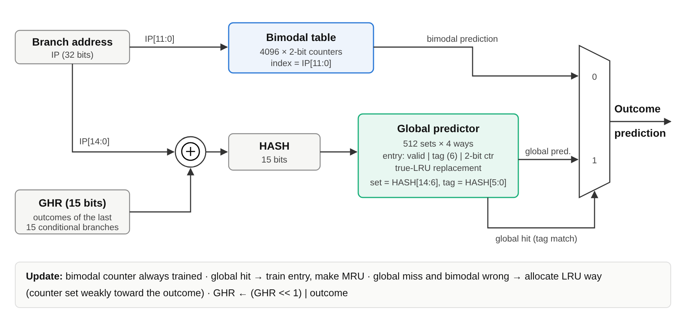
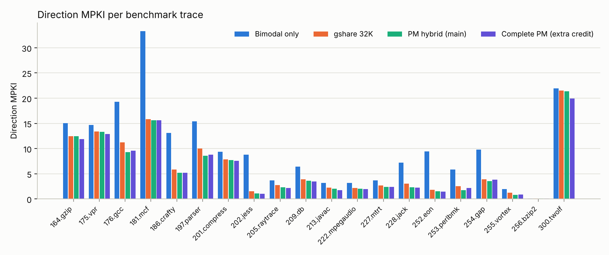
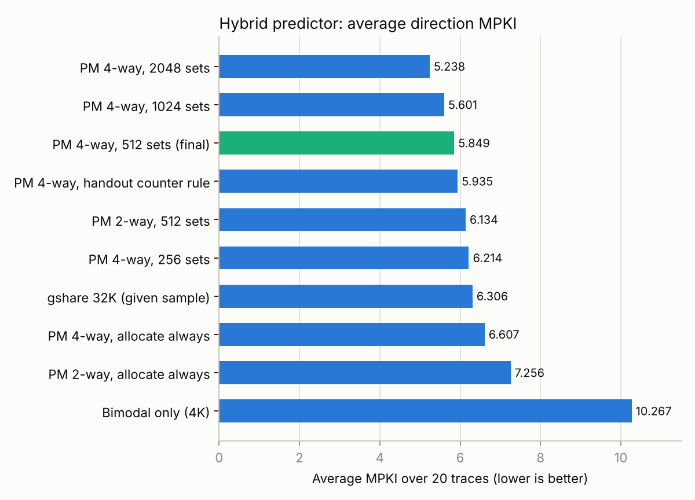
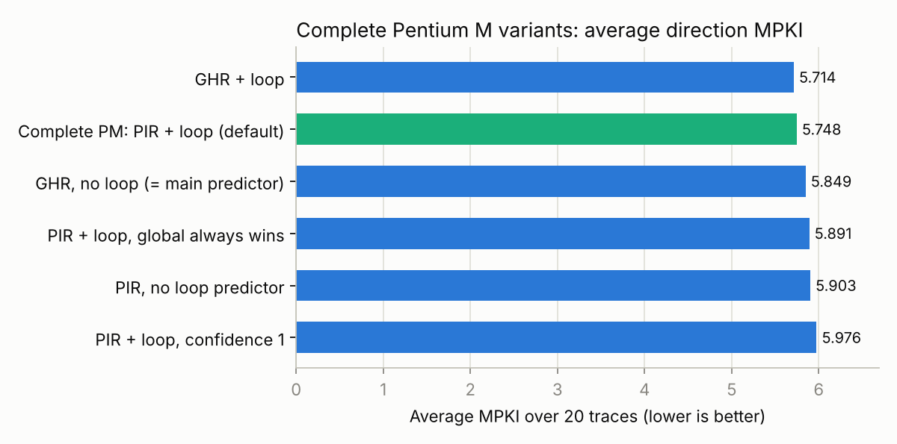

# Assignment 1: Branch Predictor Implementation
## Pentium M Hybrid Branch Predictor

**Name:** Rushi Kedhar Konduru  
**PeopleSoft ID:** 2481344  
**GitHub repository:** https://github.com/rushikedhar04/pentium-m-branch-predictor  
**Date:** October 2026

---

## Summary

I implemented the Pentium M branch outcome predictor (a 4096-entry bimodal table plus a 512-set, 4-way tagged global predictor) in the `pm_predictor` class of the CBP-2 simulator, and tested it on all 20 provided traces.

| Predictor | Avg. direction MPKI | Accuracy |
|---|--:|--:|
| Original stub (always taken) | 86.312 | 37.33% |
| Bimodal only (4096 entries) | 10.267 | 92.55% |
| Sample gshare (32K entries, 8 KB) | 6.306 | 95.42% |
| **My Pentium M hybrid (about 3.75 KB)** | **5.849** | **95.75%** |
| Extra credit: complete Pentium M | 5.748 | 95.83% |

*Accuracy = 1 − MPKI / 137.73, where 137.73 is the average number of conditional branches per 1000 instructions in these traces.*

- The hybrid beats bimodal and the sample gshare **on all 20 traces**, while using less than half of gshare's storage.
- I checked the implementation by replaying the handout's Appendix B example through my C++ class: it reproduces all **22 of 22** rows of the handout table (GHR, XOR result, row, tag and final prediction).
- I also ran 16 other configurations to see which design choices matter. The biggest one is *when* to allocate a global entry: allocating only when the bimodal predictor is wrong gives 11% fewer mispredictions than allocating on every miss.
- For extra credit, I built the complete Pentium M unit (BTB, iBTB, loop predictor and PIR path history). It brings target MPKI down from 137.7 to **6.2**. I also found and fixed a bug in the provided `predictor.h` that made target MPKI impossible to measure.

---

## 1. Background

A pipelined processor fetches instructions before it knows which way a conditional branch will go. A wrong guess flushes the pipeline, so prediction accuracy has a direct effect on performance and, for a mobile chip like the Pentium M, on power too.

- **Bimodal predictor.** A table of 2-bit saturating counters indexed by the branch address. It learns each branch's usual direction. It is cheap and works well for biased branches, but it can't learn patterns (T,N,T,N…) or branches that depend on other branches.
- **Global (history-based) predictor.** It combines the branch address with the recent history of branch outcomes, so the same branch can get a different counter depending on how it was reached. This captures correlation and short repeating patterns. gshare is the classic example: index = address XOR history.
- **Hybrid.** The Pentium M uses both. The bimodal table handles every branch, and a smaller **tagged** global table holds entries only for the branches that need history. When the global table has an entry (a *hit*), its prediction wins. The tags stop unrelated branches from sharing global counters, which is the main weakness of an untagged gshare.

## 2. Design and implementation

All code is in `cbp2-infrastructure-v2/src/my_predictor.h` (classes `pm_update` and `pm_predictor`). The simulator driver `predict.cc` was not changed.



### 2.1 Structures

| Structure | Organization | Index / tag | Per-entry state |
|---|---|---|---|
| Bimodal table | 4096 entries, direct-mapped | index = IP[11:0] | 2-bit counter |
| Global predictor | 512 sets × 4 ways, true LRU | HASH = IP[14:0] ⊕ GHR[14:0]; set = HASH[14:6], tag = HASH[5:0] | valid, 6-bit tag, 2-bit counter, 2-bit LRU age |
| Global history register (GHR) | 15 bits | — | outcomes of the last 15 conditional branches |

The sizes and bit fields come straight from the Pentium M diagram in the handout. The assignment says the PIR and its hash are not required, so the GHR plays the PIR's role in the hash. The split of the hash (upper bits select the set, lower bits form the tag) is the same as in the Appendix B example, where the upper 2 bits of the 4-bit XOR result select the row and the lower 2 bits are the tag.

### 2.2 Prediction (`predict`)

For a conditional branch:
1. Read the bimodal counter at `IP[11:0]`.
2. Compute `HASH = (IP ⊕ GHR) & 0x7FFF`, select set `HASH >> 6`, and compare the tag `HASH & 63` with the 4 ways.
3. **On a global hit, the final prediction is the hit entry's counter. On a miss it is the bimodal counter.** This is the Pentium M rule: "when global predictor delivers a hit, the final prediction will be determined by selecting the prediction from the global predictor."

Unconditional branches are predicted taken. Branch target prediction is not part of the required work, so this class returns target 0 (Section 7 covers targets).

The values needed by the update (bimodal index, set, tag, hit way and bimodal prediction) are stored in `pm_update`, the same way the sample gshare stores its index.

### 2.3 Update (`update`)

Once the real outcome is known:
1. **Bimodal:** the counter is always trained (+1 if taken, −1 if not, saturating at 0 and 3).
2. **Global hit:** the hit entry's counter is trained, and the entry becomes most-recently-used.
3. **Global miss:** if the bimodal prediction was wrong, a new entry is allocated in an invalid way, or in the LRU way if the set is full. Its tag is written and its counter is set weakly toward the real outcome (2 if taken, 1 if not). If the bimodal prediction was right, nothing is allocated.
4. **GHR:** `GHR = ((GHR << 1) | outcome) & 0x7FFF`.

**Why allocate only on a bimodal miss.** Most branches are strongly biased, and the bimodal table already gets them right. If those branches also got global entries, they would fill the table and push out the entries of the branches that really need history. Allocating only on a bimodal misprediction acts as a filter: the global table ends up holding only the "hard" branches. Section 5.1 shows this is the most important design decision.

**LRU.** Each way stores a 2-bit age (0 = MRU, 3 = LRU). On an access, every way younger than the accessed one ages by 1, and the accessed way becomes 0. This is exact LRU for 4 ways. The unit tests check that the ages in every set always remain a permutation of 0–3.

### 2.4 Parameters

The class is parameterized so that every variant in Section 5 runs from the same code:

```cpp
pm_predictor (int bim_bits = 12, int set_bits = 9, int tag_bits = 6, int ways = 4,
              bool alloc_on_bim_miss = true, bool reset_ctr_on_alloc = true);
```

The defaults are the Pentium M sizes. `ways = 2` gives the 2-way simplification the assignment allows. `reset_ctr_on_alloc = false` switches to the counter rule used in the Appendix B example.

### 2.5 Storage cost

| Structure | Bits |
|---|--:|
| Bimodal: 4096 × 2 | 8,192 |
| Global: 2048 entries × (1 valid + 6 tag + 2 counter + 2 LRU) | 22,528 |
| GHR | 15 |
| **Total** | **30,735 bits ≈ 3.75 KB** |

For comparison, the sample gshare uses 32,768 × 2 bits = 65,536 bits (8 KB).

## 3. Verification

### 3.1 Replaying the handout's Appendix B example

`experiments/appendix_b.cc` runs the handout example through the real `pm_predictor` class. It uses the example's settings: 16 local counters indexed by address bits [5:2], a 4-bit GHR, 4 rows × 2 ways with 2-bit tags, the example's initial counter values, allocation on every miss, and the example's counter rule. The output below is generated by my code. The last two columns compare my final prediction with the handout's "Final Prediction" column.

| # | Branch | Outcome | GHR | Index [5:2] | XOR | Row | Tag | Local | Global | Final (mine) | Final (handout) |
|--:|---|---|---|--:|---|--:|---|---|---|---|---|
| 1 | b1 | T | 0000 | 1 | 0001 | 0 | 01 | NT | miss | NT | NT |
| 2 | b3 | T | 0001 | 4 | 0101 | 1 | 01 | NT | miss | NT | NT |
| 3 | b1 | NT | 0011 | 1 | 0010 | 0 | 10 | T | miss | T | T |
| 4 | b2 | NT | 0110 | 11 | 1101 | 3 | 01 | T | miss | T | T |
| 5 | b3 | T | 1100 | 4 | 1000 | 2 | 00 | NT | miss | NT | NT |
| 6 | b1 | T | 1001 | 1 | 1000 | 2 | 00 | NT | hit, T | T | T |
| 7 | b3 | T | 0011 | 4 | 0111 | 1 | 11 | T | miss | T | T |
| 8 | b1 | NT | 0111 | 1 | 0110 | 1 | 10 | T | miss | T | T |
| 9 | b2 | NT | 1110 | 11 | 0101 | 1 | 01 | T | miss | T | T |
| 10 | b3 | T | 1100 | 4 | 1000 | 2 | 00 | T | hit, T | T | T |
| 11 | b1 | NT | 1001 | 1 | 1000 | 2 | 00 | NT | hit, T | T | T |
| 12 | b2 | T | 0010 | 11 | 1001 | 2 | 01 | NT | miss | NT | NT |
| 13 | b1 | NT | 0101 | 1 | 0100 | 1 | 00 | NT | miss | NT | NT |
| 14 | b2 | NT | 1010 | 11 | 0001 | 0 | 01 | T | hit, NT | NT | NT |
| 15 | b3 | T | 0100 | 4 | 0000 | 0 | 00 | T | miss | T | T |
| 16 | b1 | T | 1001 | 1 | 1000 | 2 | 00 | NT | hit, T | T | T |
| 17 | b3 | T | 0011 | 4 | 0111 | 1 | 11 | T | miss | T | T |
| 18 | b1 | NT | 0111 | 1 | 0110 | 1 | 10 | NT | miss | NT | NT |
| 19 | b2 | NT | 1110 | 11 | 0101 | 1 | 01 | NT | miss | NT | NT |
| 20 | b3 | T | 1100 | 4 | 1000 | 2 | 00 | T | hit, T | T | T |
| 21 | b1 | T | 1001 | 1 | 1000 | 2 | 00 | NT | hit, T | T | T |
| 22 | b3 | T | 0011 | 4 | 0111 | 1 | 11 | T | miss | T | T |

**All 22 rows match.** The GHR, XOR result, row and tag columns are also identical to the handout's. This confirms the indexing, the tag split, the hit/miss logic, the counter updates, the LRU replacement and the GHR update.

One detail turned up during this check. When the handout allocates a global entry, it keeps the victim's old counter value and trains it, instead of resetting it. With my default rule (reset the counter weakly toward the outcome), the example matches 21 of 22 rows and differs only at row 14. I tested both rules on the real traces (Section 5.2), and the reset rule is better, so it is the default. Both rules are in the code.

### 3.2 Unit tests

`experiments/test_pm.cc` (all passing):

| Test | Result |
|---|---|
| Appendix B example, handout rules | 22/22 rows match |
| Appendix B example, reset-counter rule | 21/22 (row 14 differs, as expected) |
| Always-taken branch | 0 mispredictions, **0** global entries allocated (the bimodal table handles it) |
| Alternating T,N | 0 mispredictions after warm-up (bimodal alone would miss about half) |
| Loop pattern T,T,T,N | 0 mispredictions after warm-up |
| 2-way configuration, pattern T,T,N,T,N | 0 mispredictions after warm-up |
| LRU ages stay a valid permutation in all 512 sets | OK |
| 30-iteration loop (extra credit, Section 7) | hybrid: 180 misses (every exit); complete PM: 0 |
| BTB target and fall-through (extra credit) | 0 target misses after warm-up |

### 3.3 Full runs

`make` builds `predict`, which uses `pm_predictor`. `run traces` needs `csh` and `dc`, so I also added `run.sh`, a bash version with the same output. Both give `average MPKI: 5.849`. The code builds without warnings using `-Wall` on g++ 13 and clang, and also compiles as C++98.

## 4. Results

**Setup.** CBP-2 infrastructure, 20 traces (SPEC CPU2000 integer plus SPECjvm98), each covering 100 million instructions. The metric is direction mispredictions of conditional branches per 1000 instructions (MPKI), so lower is better.

| Trace | Always taken | Bimodal only | gshare 32K | PM hybrid 2-way | **PM hybrid 4-way (final)** |
|---|--:|--:|--:|--:|--:|
| 164.gzip | 70.025 | 15.031 | 12.473 | 12.521 | **12.439** |
| 175.vpr | 85.312 | 14.673 | 13.415 | 13.867 | **13.298** |
| 176.gcc | 86.071 | 19.313 | 11.254 | 10.605 | **9.266** |
| 181.mcf | 102.497 | 33.271 | 15.837 | 16.402 | **15.624** |
| 186.crafty | 48.651 | 13.097 | 5.837 | 5.987 | **5.208** |
| 197.parser | 78.421 | 15.420 | 10.008 | 9.040 | **8.542** |
| 201.compress | 76.983 | 9.368 | 7.831 | 7.840 | **7.688** |
| 202.jess | 92.343 | 8.773 | 1.562 | 1.137 | **1.124** |
| 205.raytrace | 109.506 | 3.704 | 2.756 | 2.483 | **2.293** |
| 209.db | 91.451 | 6.437 | 3.909 | 3.738 | **3.608** |
| 213.javac | 109.644 | 3.198 | 2.267 | 2.139 | **2.052** |
| 222.mpegaudio | 110.339 | 3.166 | 2.188 | 2.134 | **2.031** |
| 227.mtrt | 112.022 | 3.682 | 2.657 | 2.467 | **2.389** |
| 228.jack | 77.958 | 7.175 | 3.033 | 2.422 | **2.349** |
| 252.eon | 24.226 | 9.443 | 1.807 | 1.530 | **1.506** |
| 253.perlbmk | 66.833 | 5.848 | 2.554 | 1.855 | **1.774** |
| 254.gap | 75.950 | 9.760 | 3.926 | 3.607 | **3.509** |
| 255.vortex | 70.524 | 1.930 | 1.222 | 0.859 | **0.830** |
| 256.bzip2 | 178.257 | 0.113 | 0.094 | 0.064 | **0.062** |
| 300.twolf | 59.221 | 21.943 | 21.489 | 21.982 | **21.390** |
| **Average** | **86.312** | **10.267** | **6.306** | **6.134** | **5.849** |



**Observations**

- **The hybrid beats bimodal on every trace** (10.27 → 5.85 average, 43% fewer mispredictions). The biggest gains are on branches that depend on other branches: mcf 33.3 → 15.6, gcc 19.3 → 9.3, eon 9.4 → 1.5, jess 8.8 → 1.1, jack 7.2 → 2.3. The bimodal table can't learn these, and the global table can.
- **It also beats the 8 KB sample gshare on all 20 traces** (6.31 → 5.85, 7% fewer mispredictions) with less than half the storage, because of the tagged, filtered design. gshare gives every branch a counter for every history it sees, so easy branches waste entries and unrelated branches collide on the same untagged counters. The Pentium M design handles easy branches with the cheap bimodal table and uses tags to keep the global entries for hard branches separate.
- **About 41% of conditional branches are predicted by the global table.** The rest stay with the bimodal table, which is accurate enough for them.
- **Some traces are still hard:** twolf (21.4), mcf (15.6), vpr (13.3) and gzip (12.4). Their mispredictions come from data-dependent branches (comparisons on values loaded from memory), and no address-plus-history predictor can learn those well. gshare and the larger configurations struggle on the same traces.
- **bzip2 is almost perfect** (0.06 MPKI). Its branches in this trace window are very regular.

## 5. Design-space exploration

All variants use the same code with different constructor parameters (`experiments/sweep.sh` runs all of them).

| Configuration | Avg. MPKI | Global hit rate |
|---|--:|--:|
| **4-way, 512 sets, allocate on bimodal miss, reset counter (final)** | **5.849** | 41.2% |
| 4-way, handout counter rule (keep the victim's counter) | 5.935 | 41.2% |
| 2-way, 512 sets | 6.134 | 29.7% |
| 4-way, allocate on every global miss | 6.607 | 87.1% |
| 2-way, allocate on every global miss | 7.256 | 72.7% |
| 4-way, 256 sets (14-bit history) | 6.214 | 37.1% |
| 4-way, 1024 sets (16-bit history) | 5.601 | 44.2% |
| 4-way, 2048 sets (17-bit history) | 5.238 | 46.1% |



### 5.1 Allocation policy has the largest effect

Allocating on every global miss (the policy in the Appendix B example) gives 6.607 MPKI, compared with 5.849 when allocating only on a bimodal misprediction, which is **13% more mispredictions**. The hit rate shows why: with allocate-always, the global table answers 87% of branches, but most of those entries belong to easy, biased branches the bimodal table was already predicting correctly. These entries:
1. evict the entries of hard branches (the table is effectively much smaller for the branches that matter), and
2. start cold and are trained under many different histories, so they are often *less* accurate than the bimodal counter they override.

Filtering on bimodal mispredictions keeps the global table small, focused and accurate. This is the main reason the hybrid beats gshare with less storage.

### 5.2 Counter value on allocation

The handout example keeps the victim's old counter value when it allocates. In the real runs this is worse on 19 of 20 traces (5.935 compared with 5.849). The old counter belongs to a different branch and history, so it carries no useful information. Setting it weakly toward the outcome that caused the allocation is a better starting point.

### 5.3 Associativity: 4-way versus 2-way

Two ways cost about 0.29 MPKI (6.134 compared with 5.849), and the hit rate falls from 41% to 30%. With only 2 ways, hard branches that map to the same set evict each other (conflict misses). The 2-way version still beats gshare on average (6.13 compared with 6.31), so the assignment's simplification works, but the 4-way design is clearly better.

### 5.4 Table size

256 → 512 → 1024 → 2048 sets gives 6.21 → 5.85 → 5.60 → 5.24 MPKI. Two effects are mixed here: more sets mean fewer conflicts, and because the hash width equals set bits plus tag bits, the history also grows from 14 to 17 bits. The returns are steady but get smaller, at about 0.3 MPKI for each doubling, which doubles the global table's storage. I kept 512 sets for the final version because it matches the real Pentium M.

## 6. Differences from the real Pentium M (main part)

- **GHR instead of the PIR.** The assignment allows this. The real PIR records path information (branch addresses and targets), not only outcomes. Section 7 tests a PIR.
- **No loop predictor, BTB or iBTB** in the required part. They are optional, and I added them for extra credit in Section 7.
- **Unknown internal details** (initial counter values, the exact allocation rule) are not published. I chose them as described above and gave reasons for each.

## 7. Extra credit: complete Pentium M branch predictor (`cpm_predictor`)

The handout also includes `cpm_predictor` / `predict_extra_credit` for the complete unit, covering both direction and target prediction. I implemented it in the same file.

### 7.1 Bug fix in the provided infrastructure

In `predictor.h`, the target getter was declared `bool target_prediction ()`, so every predicted target was turned into 0 or 1 before the driver compared it with the real target. As shipped, target MPKI could never be correct. I changed the return type to `unsigned int` (one line, marked with a comment). This doesn't affect the direction results of the main part.

### 7.2 Structures

All sizes follow the Pentium M diagram.

| Unit | Organization | Index / tag | Notes |
|---|---|---|---|
| BTB | 512 sets × 4 ways, tree pseudo-LRU (3 bits/set) | index IP[12:4]; tag IP[21:13] + offset IP[3:0] | stores the type and a 32-bit target; allocated for taken branches |
| iBTB | 256 sets × 4 ways, LRU | index HASH[13:6]; tag {HASH[14], HASH[5:0]} (7 bits) | path-based targets for indirect branches; allocated when the BTB target was wrong |
| Loop predictor (LPB) | 64 sets × 2 ways, LRU | index IP[9:4]; tag IP[15:10] | 6-bit count, 6-bit limit, 1-bit loop direction, 2-bit confidence |
| Bimodal | 4096 × 2-bit | IP[11:0] | same as the main part |
| Global | 512 × 4-way, 6-bit tag | HASH = IP[14:0] ⊕ PIR | same as the main part |
| PIR | 15-bit path history | — | updated on every branch |

**PIR update.** I couldn't access the ISPASS 2009 paper itself, so I used the rule from Intel's patent on this predictor (US 2005/0262332, "Method and system for branch target prediction using path information"): on every direct and indirect branch, `PIR = ((PIR ⊕ addr) << 1) | taken`, where `addr` is the branch address for direct branches and the target for indirect ones.

**Direction selection.** If the loop predictor hits, is confident and the BTB also hits (the diagram's "loop predictor hit"), the loop prediction replaces the bimodal one. A global hit then overrides both, except for one change I made (below).

**Loop predictor.** `count` counts iterations in the loop direction since the last exit. When the branch goes the other way, `limit = count` and `count = 0`. While confident, the prediction is "exit" when `count == limit`, and the loop direction otherwise. An entry is allocated on a misprediction, with the loop direction set opposite to the outcome that was just seen. It is trusted only after the same trip count has been seen 3 times in a row.

**Target prediction (next PC).** If the predicted direction is taken, the target is the iBTB target (indirect branch with an iBTB hit) or the BTB target, or 0 on a BTB miss (the decoder would fix that later). If it is not taken, the next PC is the fall-through address. The trace showed that the "target" of a not-taken branch is the next sequential instruction, 2 bytes (short `jcc`) or 6 bytes (near `jcc`) later. Real x86 fetch always knows this address from the instruction cache's predecode (length) bits. A small table of learned branch lengths stands in for those bits. Without it, wrongly guessed fall-through addresses inflated compress's target MPKI to 75. With it, the target misses that remain are real ones.

### 7.3 Two design problems I found and fixed

1. **Random branches looked like loops.** With confidence 1 (trust the loop predictor after one matching trip count), branches with random outcomes and trip counts of 0 or 1 matched by chance, and the loop predictor made things worse. Requiring 3 matching trip counts and a limit greater than 0 fixed this (5.976 → 5.748).
2. **The global predictor was hiding the loop predictor.** While a long loop is being learned, its exit mispredicts and creates a global entry under the "all taken" history. For loops longer than 15 iterations, that same history appears at every later exit, so the global entry hits and overrides the loop predictor, which by then is correct. The unit test shows this clearly: with a 30-iteration loop, the predictor missed all 180 exits even with the loop predictor on. **Giving a confident loop prediction priority over a global hit** fixes it (0 misses in the test, 5.891 → 5.748 on the traces). I also tried the other option, deleting global entries that are wrong when the base prediction was right, and it was worse (for example, gzip 13.2 compared with 11.9).

### 7.4 Results

| Trace | Main PM: direction | Complete PM: direction | Main PM: target | Complete PM: target |
|---|--:|--:|--:|--:|
| 164.gzip | 12.439 | 11.881 | 151.146 | 11.996 |
| 175.vpr | 13.298 | 12.903 | 128.272 | 13.043 |
| 176.gcc | 9.266 | 9.566 | 170.832 | 11.546 |
| 181.mcf | 15.624 | 15.591 | 217.004 | 15.673 |
| 186.crafty | 5.208 | 5.210 | 89.270 | 5.728 |
| 197.parser | 8.542 | 8.815 | 141.907 | 8.964 |
| 201.compress | 7.688 | 7.571 | 117.649 | 7.687 |
| 202.jess | 1.124 | 1.021 | 141.541 | 1.426 |
| 205.raytrace | 2.293 | 2.207 | 122.019 | 3.022 |
| 209.db | 3.608 | 3.501 | 131.918 | 4.380 |
| 213.javac | 2.052 | 1.719 | 129.866 | 2.252 |
| 222.mpegaudio | 2.031 | 1.958 | 130.212 | 2.440 |
| 227.mtrt | 2.389 | 2.356 | 125.127 | 2.916 |
| 228.jack | 2.349 | 2.277 | 119.263 | 3.037 |
| 252.eon | 1.506 | 1.430 | 77.250 | 1.690 |
| 253.perlbmk | 1.774 | 2.196 | 135.371 | 2.470 |
| 254.gap | 3.509 | 3.838 | 138.380 | 3.945 |
| 255.vortex | 0.830 | 0.903 | 110.738 | 1.840 |
| 256.bzip2 | 0.062 | 0.088 | 245.863 | 0.160 |
| 300.twolf | 21.390 | 19.920 | 130.989 | 20.044 |
| **Average** | **5.849** | **5.748** | **137.731** | **6.213** |

| Variant | Avg. direction MPKI | Avg. target MPKI |
|---|--:|--:|
| **Complete PM: PIR + loop predictor (default)** | **5.748** | **6.213** |
| GHR + loop predictor | 5.714 | 6.179 |
| PIR, no loop predictor | 5.903 | 6.368 |
| GHR, no loop predictor (same as the main predictor) | 5.849 | 6.313 |
| PIR + loop, global always overrides the loop | 5.891 | 6.356 |
| PIR + loop, loop confidence 1 | 5.976 | 6.441 |



- **Target prediction:** 137.7 → **6.2** target MPKI. Almost all remaining target misses come from direction mispredictions (a wrong direction always means a wrong next PC) plus a small number of BTB misses on the first taken execution.
- **Loop predictor:** about 0.14–0.16 MPKI better on average, with large gains on loop-heavy traces (twolf 21.4 → 19.9, javac 2.05 → 1.72, gzip 12.4 → 11.9). The gain is small overall because the 15-bit history already covers loops of up to about 15 iterations, so the loop predictor only helps longer loops with a fixed trip count.
- **PIR compared with GHR:** in my implementation, the patent-style PIR is slightly *worse* than the plain outcome history (5.748 compared with 5.714 with the loop predictor). Path history separates paths better (it helps twolf and mcf), but it also mixes in unconditional branches, calls and returns, which spreads one branch over more global entries. The real chip's exact PIR bits may differ from this patent version.
- **Sanity check:** with the loop predictor off and GHR history, `cpm_predictor` gives exactly the same direction MPKI and hit rate as `pm_predictor` (5.849, 41.2%). The two implementations agree.

**Extra-credit storage:** BTB 512×4×(1+9+4+2+32) bits + PLRU ≈ 12.2 KB; iBTB 256×4×(1+7+32) bits + LRU ≈ 5.3 KB; LPB 64×2×22 bits ≈ 0.35 KB; length table 1 KB. Together with the 3.75 KB direction predictor, the total is about 22.5 KB.

## 8. Conclusion

The Pentium M hybrid works because it splits the job: a cheap bimodal table for the many easy branches, and a small, tagged, history-based table for the few hard ones. Allocating global entries only on bimodal mispredictions is what makes the split work. My implementation reaches 5.85 MPKI (95.75% accuracy), beats a gshare that uses twice the storage on every trace, and reproduces the handout's worked example exactly. The extra-credit version adds target prediction (6.2 target MPKI) and a loop predictor. Getting the loop predictor to help required two fixes (a stronger confidence rule, and priority over the global table) that the block diagram alone doesn't show.

## 9. How to reproduce

```bash
git clone https://github.com/rushikedhar04/pentium-m-branch-predictor
cd pentium-m-branch-predictor/cbp2-infrastructure-v2/src && make && cd ..
./run traces            # or ./run.sh traces        -> average MPKI: 5.849
./run_extra.sh traces   # extra credit             -> direction 5.748, target 6.213
g++ -O2 -o experiments/test_pm experiments/test_pm.cc && experiments/test_pm
g++ -O2 -o experiments/appendix_b experiments/appendix_b.cc && experiments/appendix_b
experiments/sweep.sh && python3 experiments/plot.py     # all experiments and charts
```

## 10. Code used and references

- **Code reuse.** No outside code was copied. The set-associative global table, LRU, tree-PLRU, BTB, iBTB and loop predictor were written from scratch. The 2-bit counter update style follows the sample `gshare_predictor` in the CBP-2 infrastructure (D. A. Jiménez). I did not use the cache simulator linked in the handout (github.com/NishadSaraf/L1-Cache-Simulator).
- **Infrastructure change.** The one-line `bool` → `unsigned int` fix in `predictor.h` (Section 7.1). Added scripts: `run.sh`, `run_extra.sh` and `experiments/`.
- V. Uzelac and A. Milenkovic, "Experiment Flows and Microbenchmarks for Reverse Engineering of Branch Predictor Structures," *ISPASS 2009* (Pentium M block diagram used in the handout).
- M. Milenkovic, A. Milenkovic and J. Kulick, "Demystifying Intel Branch Predictors," *WDDD 2002*.
- Intel Corporation, "Method and system for branch target prediction using path information," US Patent Application 2005/0262332 (PIR update rule).
- D. A. Jiménez, CBP-2 branch prediction competition infrastructure, 2006.
- S. McFarling, "Combining Branch Predictors," DEC WRL Technical Note TN-36, 1993 (bimodal, gshare and hybrid predictors).
- Course handout, "Assignment 1: Branch Predictor Implementation," including Appendix B.
